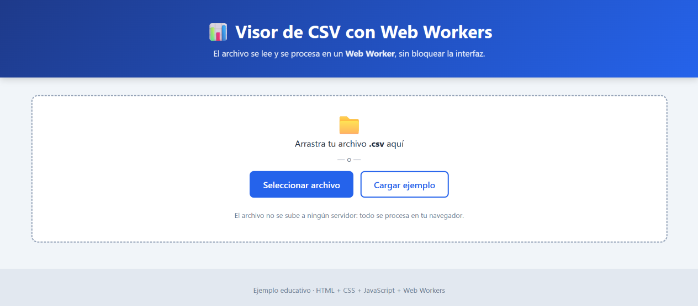
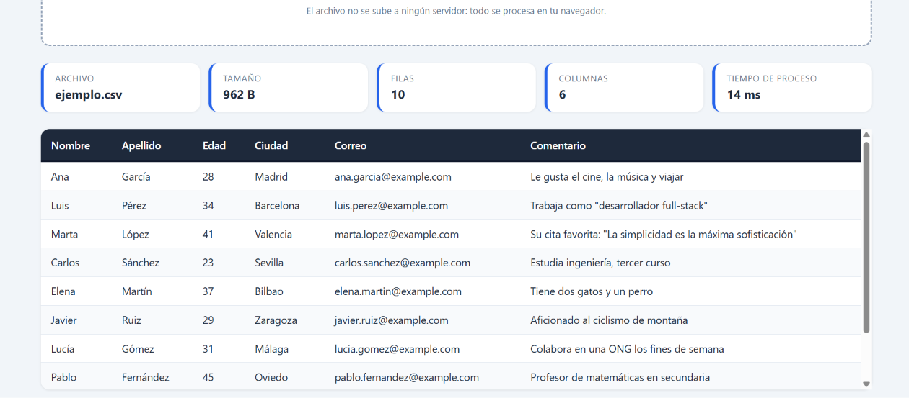

# 📊 Visor de CSV con Web Workers

Ejemplo educativo de uso de **Web Workers** en JavaScript: una página que permite
cargar un archivo `.csv` y lo muestra en una tabla HTML **sin bloquear la interfaz**,
porque la lectura y el parseo del archivo se ejecutan en un hilo secundario.


---

## 🚀 Demo



---

## 📁 Estructura del proyecto

```
.
├── index.html          # Interfaz
├── css/
│   └── styles.css      # Estilos
├── js/
│   ├── main.js         # Hilo principal (UI)
│   └── worker.js       # Web Worker (lectura + parseo CSV)
├── data/
│   └── ejemplo.csv     # CSV de prueba
└── README.md
```

---

## 🧠 ¿Cómo funciona?

```
┌──────────────────────────┐        postMessage(file)        ┌───────────────────────────┐
│   HILO PRINCIPAL (UI)    │ ──────────────────────────────► │       WEB WORKER          │
│                          │                                 │                           │
│  main.js                 │ ◄────────────────────────────── │  worker.js                │
│  - Captura el archivo    │   { type:'progress' | 'done' }  │  - file.text()            │
│  - Muestra el progreso   │                                 │  - parseCSV()             │
│  - Pinta la tabla        │                                 │  - postMessage(resultado) │
└──────────────────────────┘                                 └───────────────────────────┘
```

1. El usuario selecciona o arrastra un archivo `.csv`.
2. `main.js` crea un `Worker` y le envía el objeto `File` (es *structured-cloneable*).
3. El worker lee el archivo con `file.text()` y lo parsea carácter a carácter,
   notificando el progreso con `postMessage`.
4. Al terminar, devuelve las cabeceras y las filas ya normalizadas.
5. `main.js` construye la tabla con `DocumentFragment` (rendimiento) y `textContent`
   (seguridad frente a XSS).

---

## ✨ Características

- ✅ Procesamiento 100 % en el cliente (nada se sube a un servidor).
- ✅ Interfaz fluida incluso con archivos grandes.
- ✅ Parser CSV propio que soporta:
  - campos entrecomillados `"texto, con comas"`
  - comillas escapadas `"Dijo ""hola"""`
  - saltos de línea dentro de comillas
  - finales de línea `\n` y `\r\n`
  - BOM UTF-8
- ✅ Barra de progreso en tiempo real.
- ✅ Arrastrar y soltar (drag & drop).
- ✅ Validación de extensión y de tamaño (máx. 50 MB).
- ✅ Límite de filas renderizadas (10 000) para no saturar el DOM.
- ✅ Diseño responsive.

---

## 🖥️ Ejecución local

> ⚠️ **Importante:** los Web Workers **no funcionan** abriendo `index.html`
> con doble clic (`file://`), por la política de *same-origin* del navegador.
> Es necesario servir la carpeta por HTTP.

**Opción A — Python**

```bash
python3 -m http.server 8000
# Abrir http://localhost:8000
```

**Opción B — Node.js**

```bash
npx serve .
```

**Opción C — VS Code**

Instala la extensión *Live Server* y pulsa **"Go Live"**.

---

## 🌐 Publicar en GitHub Pages

```bash
git init
git add .
git commit -m "Ejemplo de Web Workers: visor CSV"
git branch -M main
git remote add origin https://github.com/<tu-usuario>/<tu-repo>.git
git push -u origin main
```

Luego en GitHub: **Settings → Pages → Source: Deploy from a branch → main / (root) → Save**.

En un par de minutos la app estará disponible en línea.

---

## 📄 Entrega (ZIP + PDF)

1. **ZIP:** comprime la carpeta del proyecto completa
   (`index.html`, `css/`, `js/`, `data/`, `README.md`).

   ```bash
   zip -r visor-csv-webworkers.zip index.html css js data README.md
   ```

2. **PDF con capturas:** abre la página en el navegador y captura:
   - Pantalla inicial (zona de carga).
   - Estado de progreso durante el procesamiento.
   - Tabla resultante con el panel de información.
   - Consola del navegador (`F12 → Application → Web Workers`) mostrando el worker activo.

   Pega las imágenes en un documento (Word/Docs) y expórtalo a PDF.

---

## 📚 Conceptos demostrados

| Concepto                         | Dónde                                          |
|----------------------------------|------------------------------------------------|
| Crear un Web Worker              | `new Worker('js/worker.js')`                   |
| Enviar datos al worker           | `worker.postMessage({ file })`                 |
| Recibir resultados               | `worker.onmessage`                             |
| Comunicación bidireccional tipada| `{ type, payload }`                            |
| Manejo de errores del worker     | `worker.onerror`                               |
| Terminar el worker               | `worker.terminate()`                           |
| Estructuras clonables            | Objeto `File` enviado al worker                |
| Render eficiente                 | `DocumentFragment`                             |

---

## 🧪 Pruebas sugeridas

- Cargar el archivo `data/ejemplo.csv` con el botón **"Cargar ejemplo"**.
- Arrastrar un `.csv` propio a la zona de carga.
- Probar con un CSV grande (por ejemplo, exportado de Excel con miles de filas)
  y comprobar que la interfaz **sigue respondiendo** mientras se procesa.
- Probar con un archivo que tenga comas dentro de comillas y comillas escapadas.
- Probar con un archivo que **no** sea `.csv` para ver la validación.

---

## 👤 Autor

**Nicolle Andrea Lozano Vega**
- GitHub: [@nicolle-lo-ve](https://github.com/nicolle-lo-ve)
- Ejercicio académico · 2026
